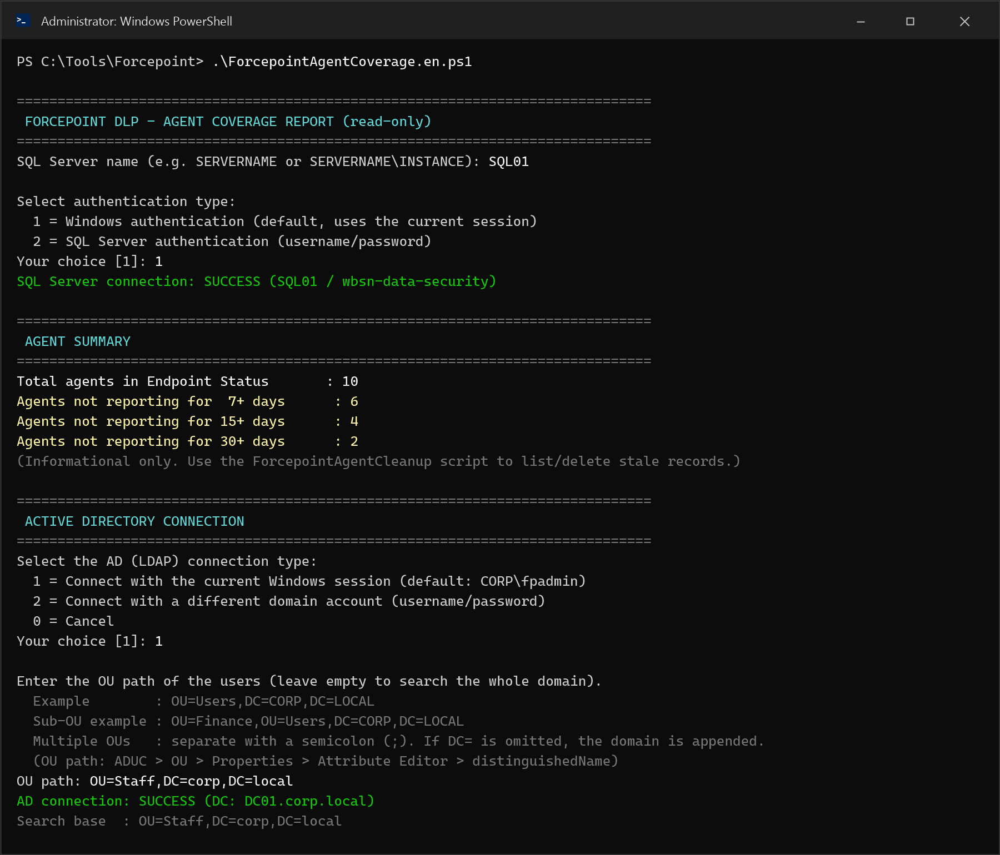
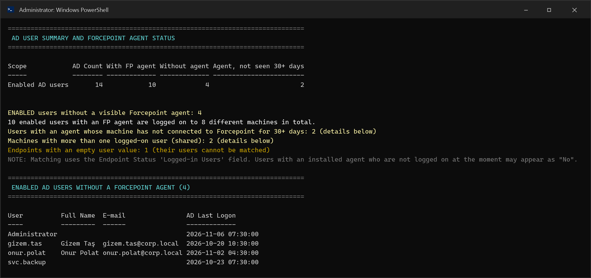
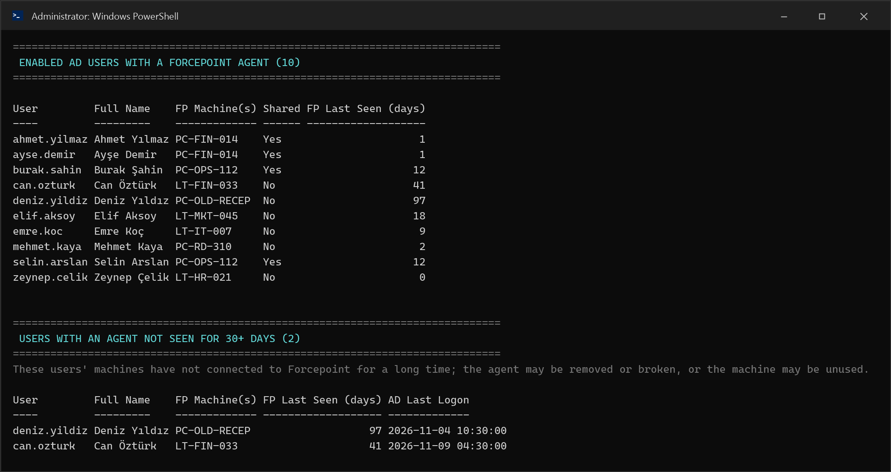
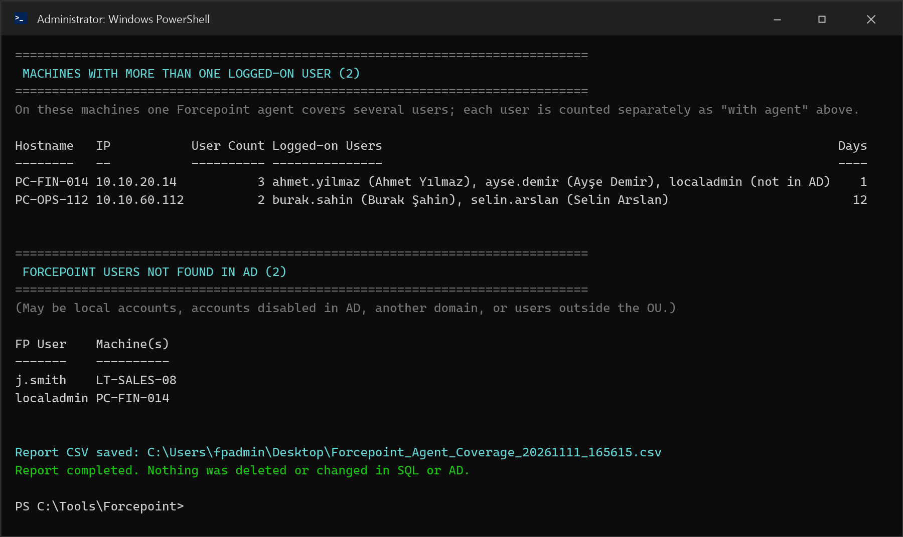
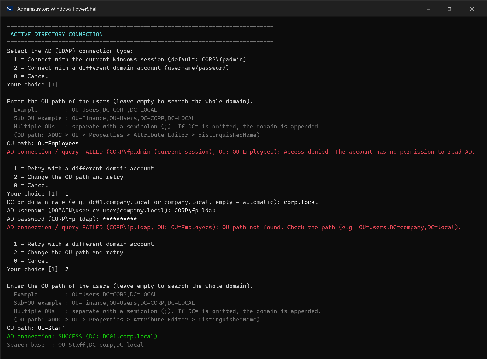
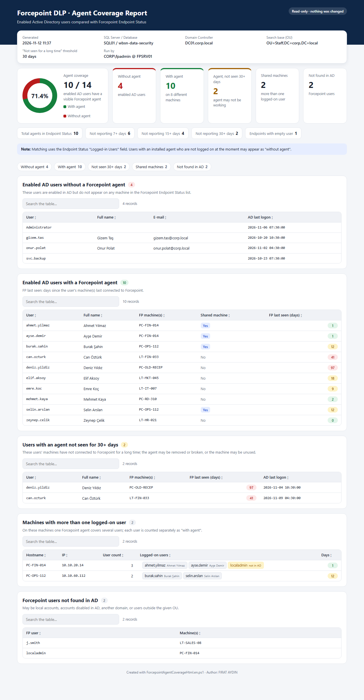
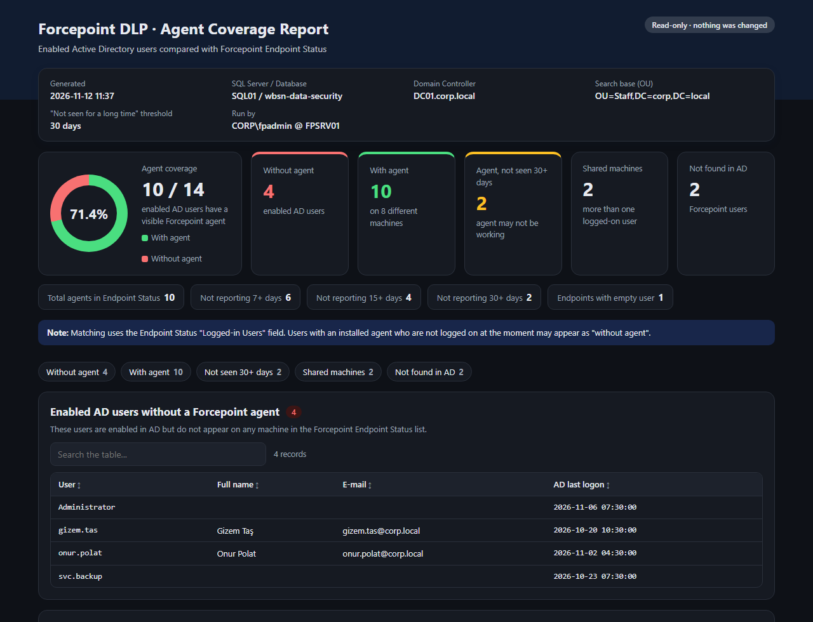

[Türkçe](README.md) | **English**

# Forcepoint DLP - Agent Coverage Report

`ForcepointAgentCoverage.en.ps1` compares the enabled users in Active Directory with the users in the Forcepoint Security Manager (FSM) **Status > Endpoint Status** list. It finds and reports **users that do not appear to have a Forcepoint agent installed**.

> **Read-only.** Nothing is deleted or changed in the SQL database or in Active Directory. Use the separate [ForcepointAgentCleanup](https://github.com/fiirataydiin/forcepoint-dlp-endpoint-cleanup) script to delete stale Endpoint Status records.

## Files

| File | Description |
|---|---|
| `ForcepointAgentCoverage.ps1` | Console report + CSV (Turkish) |
| `ForcepointAgentCoverage.en.ps1` | Console report + CSV (English) |
| `ForcepointAgentCoverageHtml.ps1` | Console report + CSV + **HTML report** (Turkish) |
| `ForcepointAgentCoverageHtml.en.ps1` | Console report + CSV + **HTML report** (English) |

The HTML scripts do the same as the coverage scripts and additionally create an HTML report. See the [HTML report](#html-report) section for details.

## What it does

1. Connects to SQL Server (`sqlcmd.exe`, Windows or SQL Server authentication) and reads the Endpoint Status list.
2. Shows a short agent summary: total agents and agents not reporting for 7 / 15 / 30 days. This part is informational only.
3. Connects to Active Directory and reads the **enabled** users in the given OU path.
4. Matches the AD users with the `Logged-in Users` value in Endpoint Status and reports these sections:
   - **Summary:** the number of enabled AD users, users with an FP agent, users without one, and users with an agent that has not been seen for a long time.
   - Enabled AD users **without** a Forcepoint agent.
   - Enabled AD users **with** a Forcepoint agent, with machine, shared machine and last seen details.
   - **Users with an agent whose machine has not been seen for 30+ days.** For these users the agent may be removed or broken, or the machine may be unused.
   - **Machines with more than one logged-on user.** On these machines one agent covers several users.
   - **Forcepoint users not found in AD.** These may be local accounts, accounts disabled in AD, another domain, or users outside the given OU.
5. Saves the full result to the desktop as `Forcepoint_Agent_Coverage_<date>.csv`.

## How AD users are found

The query uses .NET `System.DirectoryServices` (LDAP); no RSAT / ActiveDirectory module is needed. Only **enabled** users are read. The LDAP filter used:

```text
(&(objectCategory=person)(objectClass=user)(!(objectClass=computer))(!(userAccountControl:1.2.840.113556.1.4.803:=2)))
```

- User accounts have `objectClass` = `top; person; organizationalPerson; user`. Groups (`top; group`) are not included.
- Computer accounts also contain `person` and `user` in `objectClass`. They are therefore excluded separately with `objectCategory=person` and `!(objectClass=computer)`.
- Disabled accounts are excluded with the `userAccountControl` filter.

## AD connection and OU selection

- **Connection type:**
  - `1` = Current Windows session
  - `2` = A different domain account. The DC/domain name, username and password are entered on screen; the password is read securely and never stored.
  - `0` = Cancel
- **OU path:**
  - Leave it empty to search the whole domain.
  - Multiple OUs can be entered, separated by `;`.
  - If `DC=` is omitted, the domain is appended automatically. For example, typing `OU=Users` is enough.
  - To find the OU path: ADUC > OU > Properties > Attribute Editor > `distinguishedName`.
- **On error:** For a wrong password, access denied or an OU that is not found, a readable message is shown. You can then retry with a different account or a different OU (up to 3 attempts).

## Matching

- The Endpoint Status `Logged-in Users` (`eps_os_LoggedInUsers`) field supports `DOMAIN\user`, `user@domain` and multiple users separated by `;`. The domain part is removed.
- On the AD side, it is compared with `sAMAccountName`, the part of the UPN before `@`, and `displayName`. Matching is case-insensitive.

> Note: Matching is based on the users logged on at the moment. Users who have an agent installed but are not logged on at the moment may appear as "without agent".

## Usage

```powershell
.\ForcepointAgentCoverage.en.ps1
```

```powershell
.\ForcepointAgentCoverage.en.ps1 -SqlServerInstance "SQL01" -SqlAuthMode SqlLogin -SqlUserName sa
```

```powershell
.\ForcepointAgentCoverage.en.ps1 -AdServer DC01.company.local -AdUseCredential -AdSearchBase "OU=Users,DC=company,DC=local"
```

| Parameter | Default | Description |
|---|---|---|
| `-SqlServerInstance` | (prompted) | SQL Server name, e.g. `SERVER` or `SERVER\INSTANCE` |
| `-SqlDatabaseName` | `wbsn-data-security` | Forcepoint DLP database |
| `-SqlAuthMode` | (prompted) | `Windows` or `SqlLogin` |
| `-SqlUserName` | (prompted) | SQL Login username; the password is prompted securely |
| `-AdServer` | (automatic) | DC or domain name |
| `-AdSearchBase` | (prompted) | OU path of the users; multiple OUs separated by `;` |
| `-AdUseCredential` | off | Skips the connection menu and asks for a different domain account directly |
| `-StaleDays` | `30` | "Agent present but not seen for a long time" threshold (days) |

`ForcepointAgentCoverage.ps1` is the same script with Turkish screen text. Both scripts have the same parameters and logic.

## HTML report

In addition to the console report and the CSV, `ForcepointAgentCoverageHtml.en.ps1` creates a **single-file HTML report** and opens it in the default browser. The report is saved next to the CSV as `Forcepoint_Agent_Coverage_<date>.html`.

- **Single file, no internet needed.** CSS and JavaScript are embedded; there are no external links. It works on an FSM server without internet access and can be sent by e-mail.
- **Coverage ring:** the share of users with an agent, e.g. "71.4% · 10 / 14".
- **Summary cards:** users without an agent, users with an agent, users not seen for 30+ days, shared machines, and users not found in AD.
- **Endpoint Status summary:** total agents and agents not reporting for 7 / 15 / 30+ days.
- **Tables:** every section has a search box, and clicking a column header sorts the table.
- **Colored day labels:** threshold and above in red, 7+ days in amber, below in green.
- **Light / dark theme:** chosen automatically from the computer's theme setting. It also looks right on phones and when printed.
- All data is written to the HTML safely (encoded).

```powershell
.\ForcepointAgentCoverageHtml.en.ps1
```

```powershell
.\ForcepointAgentCoverageHtml.en.ps1 -OutputFolder "D:\Reports" -NoOpen
```

In addition to all the parameters above, the HTML script supports:

| Parameter | Default | Description |
|---|---|---|
| `-OutputFolder` | desktop | Folder for the CSV and HTML report |
| `-NoOpen` | off | Does not open the HTML report in the browser after creating it (for scheduled tasks) |

`ForcepointAgentCoverageHtml.ps1` creates the same report in Turkish.

### Requirements

- Windows PowerShell 5.1+
- `sqlcmd.exe` in PATH (SQL Server Command Line Utilities or SSMS)
- **Read** permission on the `PA_DYNAMIC_STATUS` and `PA_DYNAMIC_STATUS_PROPS` tables (`db_datareader` is enough)
- LDAP (389) access to a DC and a domain account that can read AD. The default "Authenticated Users" read permission is enough.

### When copying the file

- Transfer the script **as a file** (preferably in a zip), not by copying and pasting its content. If a line is added to the top of the file while copying, you get the `Unexpected attribute 'CmdletBinding'` error.
- The files are saved as **UTF-8 with BOM**. If saved with a different encoding, Turkish characters are displayed incorrectly.
- If a downloaded file is blocked: `Unblock-File .\ForcepointAgentCoverage.en.ps1` (for the HTML script: `Unblock-File .\ForcepointAgentCoverageHtml.en.ps1`)

## Screenshots

> The screenshots are from a test run with sample data. Hostnames, IPs, the domain and usernames are not real.

### 1. SQL connection, agent summary, AD connection and OU selection



### 2. AD user summary and users without a Forcepoint agent



### 3. Users with an agent and users not seen for 30+ days



### 4. Shared machines and Forcepoint users not found in AD



### 5. AD access error, retry with a different account and a different OU



### 6. HTML report (light theme, full page)



### 7. HTML report (dark theme)



---

Author: FIRAT AYDIN
