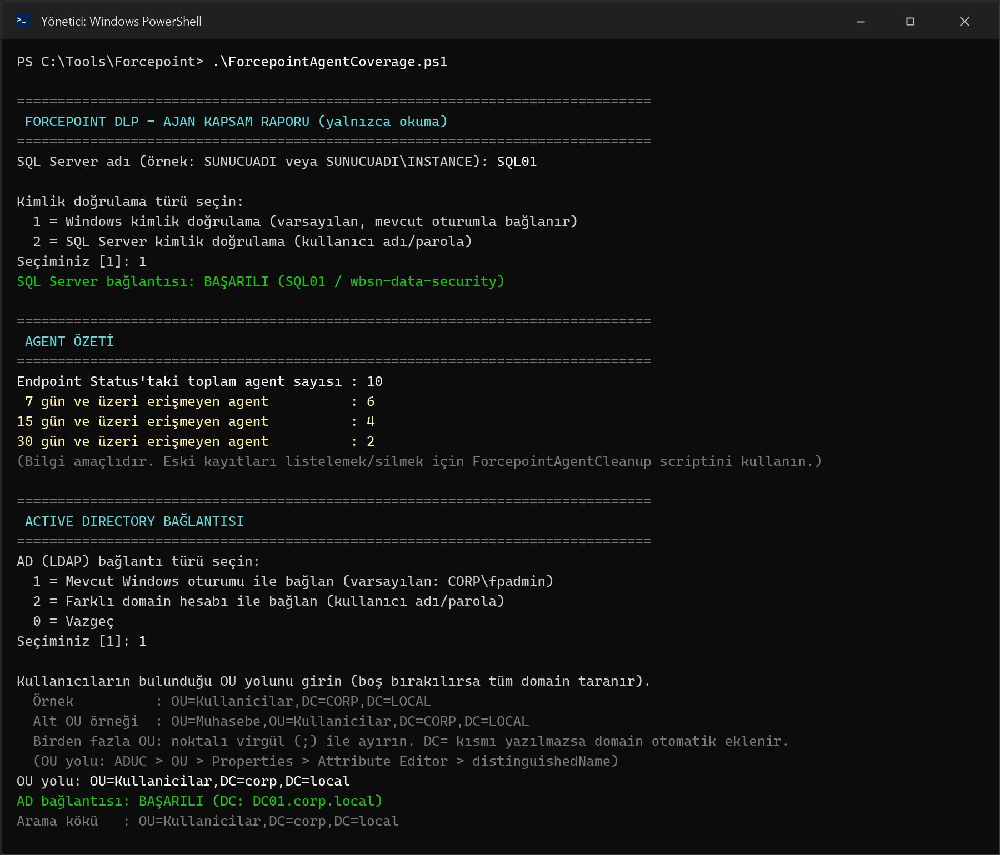
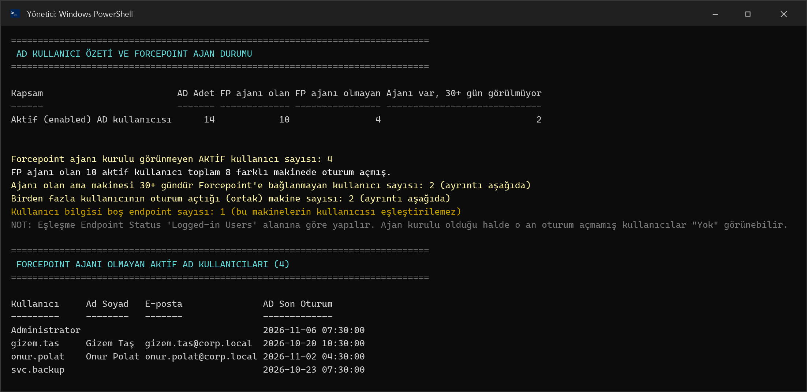
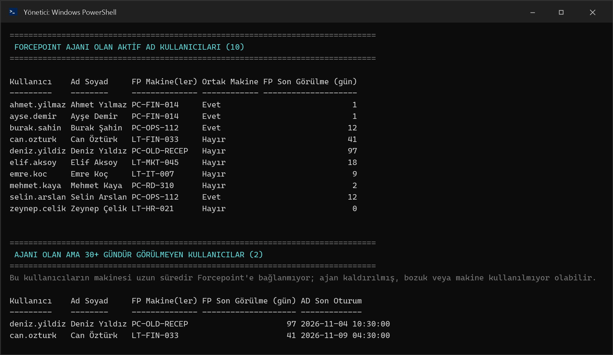
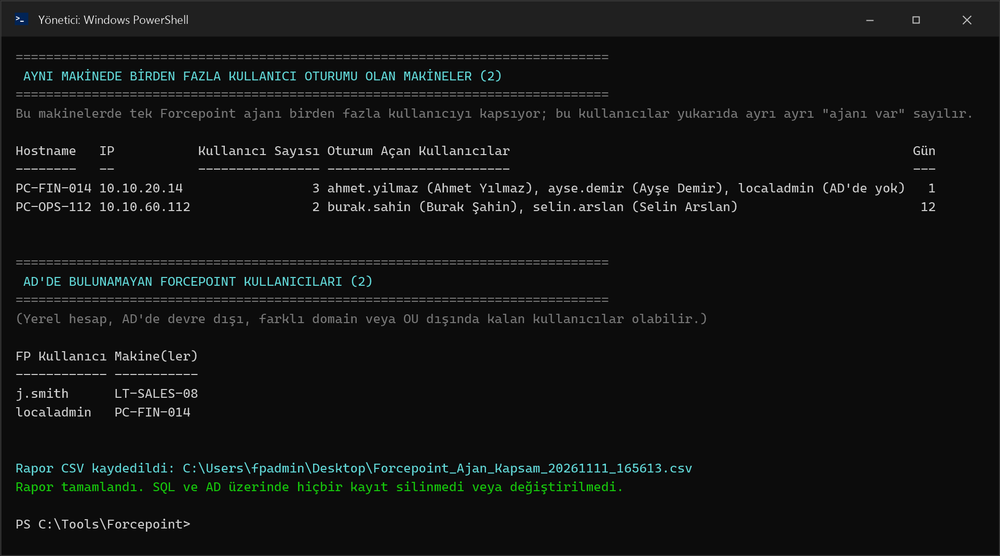
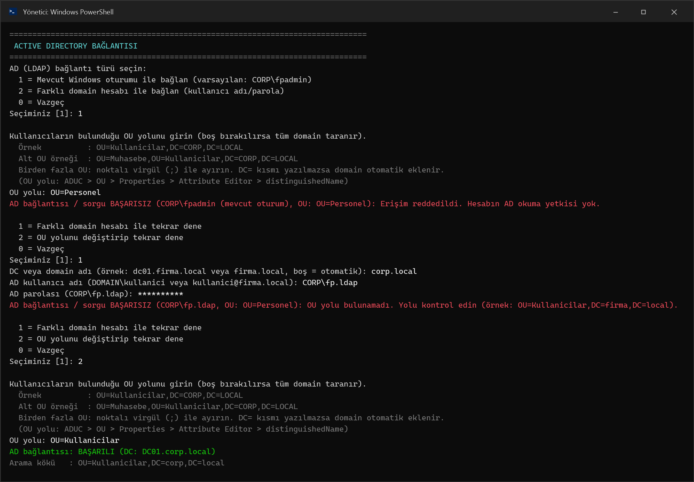
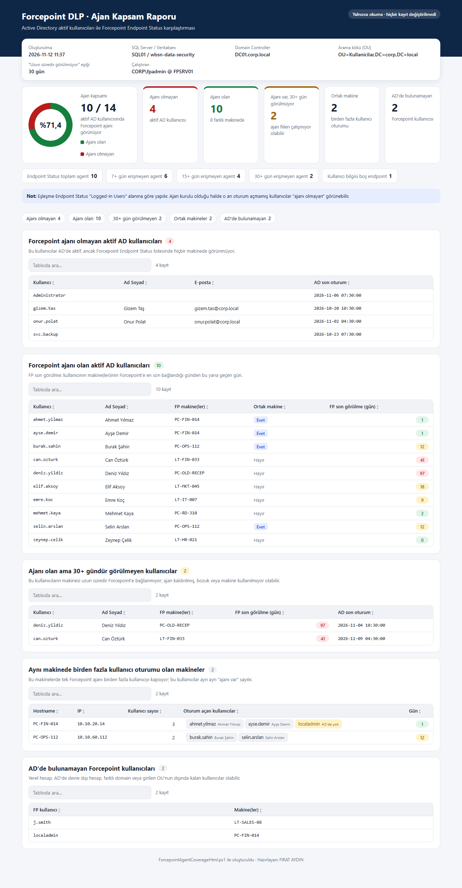
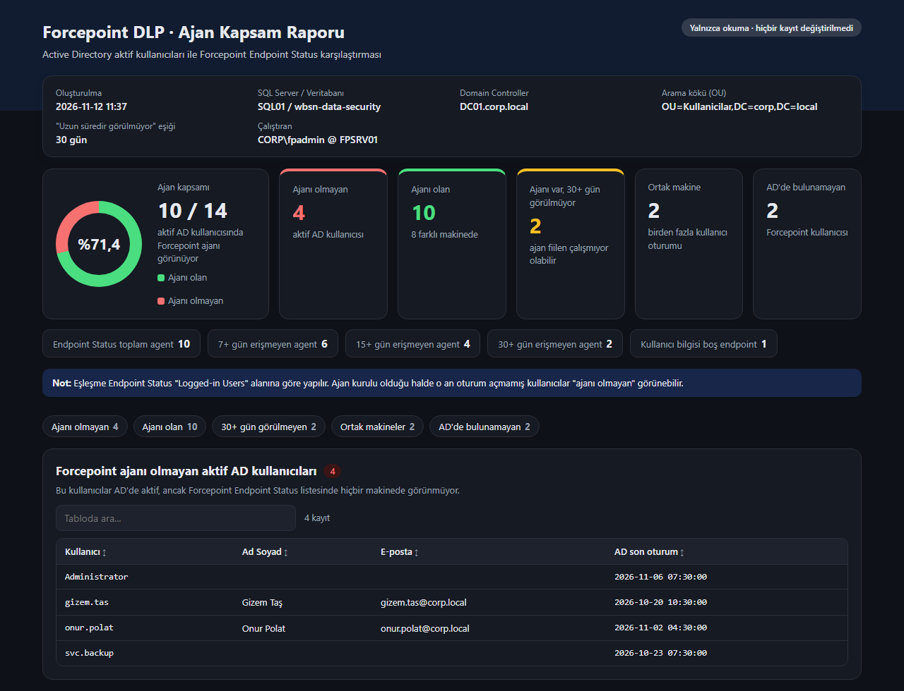

**Türkçe** | [English](README.en.md)

# Forcepoint DLP - Ajan Kapsam Raporu

`ForcepointAgentCoverage.ps1`, Active Directory'deki aktif kullanıcıları Forcepoint Security Manager (FSM) **Status > Endpoint Status** listesindeki kullanıcılarla karşılaştırır. Böylece **Forcepoint ajanı kurulu görünmeyen kullanıcıları** bulur ve raporlar.

> **Yalnızca okuma yapar.** SQL veritabanında ve Active Directory'de hiçbir kayıt silinmez veya değiştirilmez. Eski Endpoint Status kayıtlarını silmek için ayrı [ForcepointAgentCleanup](https://github.com/fiirataydiin/forcepoint-dlp-endpoint-cleanup) scriptini kullanın.

## Dosyalar

| Dosya | Açıklama |
|---|---|
| `ForcepointAgentCoverage.ps1` | Konsol raporu + CSV (Türkçe) |
| `ForcepointAgentCoverage.en.ps1` | Konsol raporu + CSV (İngilizce) |
| `ForcepointAgentCoverageHtml.ps1` | Konsol raporu + CSV + **HTML rapor** (Türkçe) |
| `ForcepointAgentCoverageHtml.en.ps1` | Konsol raporu + CSV + **HTML rapor** (İngilizce) |

HTML scriptleri, coverage scriptleriyle aynı işi yapar ve ek olarak bir HTML rapor üretir. Ayrıntılar için [HTML rapor](#html-rapor) bölümüne bakın.

## Ne yapar?

1. SQL Server'a bağlanır (`sqlcmd.exe`, Windows veya SQL Server kimlik doğrulama) ve Endpoint Status listesini okur.
2. Kısa bir agent özeti verir: toplam agent sayısı ve 7 / 15 / 30 gündür erişmeyen agent sayıları. Bu kısım bilgi amaçlıdır.
3. Active Directory'ye bağlanır ve girilen OU yolundaki **aktif** kullanıcıları okur.
4. AD kullanıcılarını Endpoint Status'taki `Logged-in Users` bilgisiyle eşleştirir ve şu bölümleri raporlar:
   - **Özet:** aktif AD kullanıcısı, FP ajanı olan, olmayan ve ajanı olup uzun süredir görülmeyen kullanıcı sayıları.
   - Forcepoint ajanı **olmayan** aktif AD kullanıcıları.
   - Forcepoint ajanı **olan** aktif AD kullanıcıları: makine, ortak makine ve son görülme bilgisiyle.
   - **Ajanı olan ama makinesi 30+ gündür görülmeyen kullanıcılar.** Bu kullanıcılarda ajan kaldırılmış veya bozuk olabilir, ya da makine kullanılmıyor olabilir.
   - **Aynı makinede birden fazla kullanıcı oturumu olan makineler.** Bu makinelerde tek ajan birden fazla kullanıcıyı kapsar.
   - **AD'de bulunamayan Forcepoint kullanıcıları.** Bunlar yerel hesap, AD'de devre dışı hesap, farklı domain veya girilen OU'nun dışında kalan kullanıcı olabilir.
5. Tüm sonucu masaüstüne `Forcepoint_Ajan_Kapsam_<tarih>.csv` olarak kaydeder.

## AD kullanıcı tespiti

Sorgu .NET `System.DirectoryServices` (LDAP) ile yapılır, RSAT / ActiveDirectory modülü gerekmez. Yalnızca **aktif** kullanıcılar alınır. Kullanılan LDAP filtresi:

```text
(&(objectCategory=person)(objectClass=user)(!(objectClass=computer))(!(userAccountControl:1.2.840.113556.1.4.803:=2)))
```

- Kullanıcı hesaplarının `objectClass` değeri `top; person; organizationalPerson; user` şeklindedir. Gruplar (`top; group`) alınmaz.
- Bilgisayar hesaplarının `objectClass` değerinde de `person` ve `user` geçer. Bu yüzden `objectCategory=person` ve `!(objectClass=computer)` ile ayrıca elenirler.
- Devre dışı (disabled) hesaplar `userAccountControl` filtresiyle elenir.

## AD bağlantısı ve OU seçimi

- **Bağlantı türü:**
  - `1` = Mevcut Windows oturumu
  - `2` = Farklı domain hesabı. DC/domain adı, kullanıcı adı ve parola ekrandan girilir; parola güvenli şekilde alınır ve kaydedilmez.
  - `0` = Vazgeç
- **OU yolu:**
  - Boş bırakılırsa tüm domain taranır.
  - `;` ile birden fazla OU girilebilir.
  - `DC=` kısmı yazılmazsa domain otomatik eklenir. Örneğin `OU=Kullanicilar` yazmak yeterlidir.
  - OU yolunu bulmak için: ADUC > OU > Properties > Attribute Editor > `distinguishedName`.
- **Hata olursa:** Yanlış parola, erişim reddi veya bulunamayan OU gibi durumlarda anlaşılır bir açıklama gösterilir. Ardından farklı hesapla ya da farklı OU ile tekrar denenebilir (en fazla 3 deneme).

## Eşleştirme

- Endpoint Status `Logged-in Users` (`eps_os_LoggedInUsers`) alanında `DOMAIN\kullanici`, `kullanici@domain` ve `;` ile ayrılmış birden fazla kullanıcı desteklenir. Domain kısmı atılır.
- AD tarafında `sAMAccountName`, UPN'in `@` öncesi ve `displayName` ile karşılaştırılır. Büyük/küçük harf fark etmez.

> Not: Eşleşme o an oturum açmış kullanıcıya göre yapılır. Ajanı kurulu olduğu halde o an oturum açmamış kullanıcılar "ajanı yok" görünebilir.

## Kullanım

```powershell
.\ForcepointAgentCoverage.ps1
```

```powershell
.\ForcepointAgentCoverage.ps1 -SqlServerInstance "SQL01" -SqlAuthMode SqlLogin -SqlUserName sa
```

```powershell
.\ForcepointAgentCoverage.ps1 -AdServer DC01.firma.local -AdUseCredential -AdSearchBase "OU=Kullanicilar,DC=firma,DC=local"
```

| Parametre | Varsayılan | Açıklama |
|---|---|---|
| `-SqlServerInstance` | (sorulur) | SQL Server adı, örn. `SUNUCU` veya `SUNUCU\INSTANCE` |
| `-SqlDatabaseName` | `wbsn-data-security` | Forcepoint DLP veritabanı |
| `-SqlAuthMode` | (sorulur) | `Windows` veya `SqlLogin` |
| `-SqlUserName` | (sorulur) | SQL Login kullanıcı adı; parola güvenli olarak sorulur |
| `-AdServer` | (otomatik) | DC veya domain adı |
| `-AdSearchBase` | (sorulur) | Kullanıcıların bulunduğu OU yolu; `;` ile birden fazla OU |
| `-AdUseCredential` | kapalı | Bağlantı menüsünü atlayıp doğrudan farklı domain hesabı sorar |
| `-StaleDays` | `30` | "Ajanı var ama uzun süredir görülmüyor" eşiği (gün) |

İngilizce ekran metinleri için `ForcepointAgentCoverage.en.ps1` kullanılabilir. İki scriptin parametreleri ve mantığı aynıdır.

## HTML rapor

`ForcepointAgentCoverageHtml.ps1`, konsol raporu ve CSV'ye ek olarak **tek dosyalık bir HTML rapor** üretir ve varsayılan tarayıcıda açar. Rapor CSV ile aynı klasöre `Forcepoint_Ajan_Kapsam_<tarih>.html` adıyla kaydedilir.

- **Tek dosya, internet gerekmez.** CSS ve JavaScript dosyanın içindedir, dış bağlantı yoktur. İnternete çıkışı olmayan bir FSM sunucusunda da çalışır, e-postayla gönderilebilir.
- **Kapsam halkası:** ajanı olan kullanıcıların oranı, örneğin "%71,4 · 10 / 14".
- **Özet kartları:** ajanı olmayan, ajanı olan, 30+ gündür görülmeyen, ortak makine ve AD'de bulunamayan kullanıcı sayıları.
- **Endpoint Status özeti:** toplam agent ve 7 / 15 / 30+ gündür erişmeyen agent sayıları.
- **Tablolar:** her bölümde arama kutusu vardır (Türkçe karakterlere duyarlı). Sütun başlığına tıklayınca sıralanır.
- **Renkli gün etiketleri:** eşik ve üzeri kırmızı, 7 gün ve üzeri sarı, altı yeşil.
- **Açık / koyu tema:** bilgisayarın tema ayarına göre otomatik seçilir. Telefonda ve yazdırırken de düzgün görünür.
- Tüm veriler HTML'e güvenli şekilde (encode edilerek) yazılır.

```powershell
.\ForcepointAgentCoverageHtml.ps1
```

```powershell
.\ForcepointAgentCoverageHtml.ps1 -OutputFolder "D:\Raporlar" -NoOpen
```

HTML scripti, yukarıdaki tüm parametrelere ek olarak şunları destekler:

| Parametre | Varsayılan | Açıklama |
|---|---|---|
| `-OutputFolder` | masaüstü | CSV ve HTML raporun kaydedileceği klasör |
| `-NoOpen` | kapalı | HTML raporu oluşturduktan sonra tarayıcıda açmaz (zamanlanmış görevler için) |

İngilizce rapor için `ForcepointAgentCoverageHtml.en.ps1` kullanılabilir.

### Gereksinimler

- Windows PowerShell 5.1+
- PATH'te `sqlcmd.exe` (SQL Server Command Line Utilities veya SSMS)
- Veritabanında `PA_DYNAMIC_STATUS` ve `PA_DYNAMIC_STATUS_PROPS` tabloları için **okuma** yetkisi (`db_datareader` yeterlidir)
- DC'ye LDAP (389) erişimi ve AD okuma yetkisi olan bir domain hesabı. Varsayılan "Authenticated Users" okuma yetkisi yeterlidir.

### Dosyayı aktarırken

- Scripti içeriğini kopyala-yapıştır yaparak değil, **dosya olarak** (tercihen zip içinde) aktarın. Kopyalama sırasında dosyanın başına satır eklenirse `Unexpected attribute 'CmdletBinding'` hatası alınır.
- Dosyalar **UTF-8 (BOM'lu)** kaydedilmiştir. Farklı bir kodlamayla kaydedilirse Türkçe karakterler bozuk görünür.
- İnternetten indirilen dosya engellenirse: `Unblock-File .\ForcepointAgentCoverage.ps1` (HTML scripti için `Unblock-File .\ForcepointAgentCoverageHtml.ps1`)

## Ekran görüntüleri

> Görüntüler örnek verilerle yapılan bir test çalıştırmasından alınmıştır. Hostname, IP, domain ve kullanıcı adları gerçek değildir.

### 1. SQL bağlantısı, agent özeti, AD bağlantısı ve OU seçimi



### 2. AD kullanıcı özeti ve Forcepoint ajanı olmayan kullanıcılar



### 3. Ajanı olan kullanıcılar ve 30+ gündür görülmeyenler



### 4. Ortak makineler ve AD'de bulunamayan Forcepoint kullanıcıları



### 5. AD erişim hatası, farklı hesapla ve farklı OU ile tekrar deneme



### 6. HTML rapor (açık tema, tam sayfa)



### 7. HTML rapor (koyu tema)



---

Hazırlayan: FIRAT AYDIN
